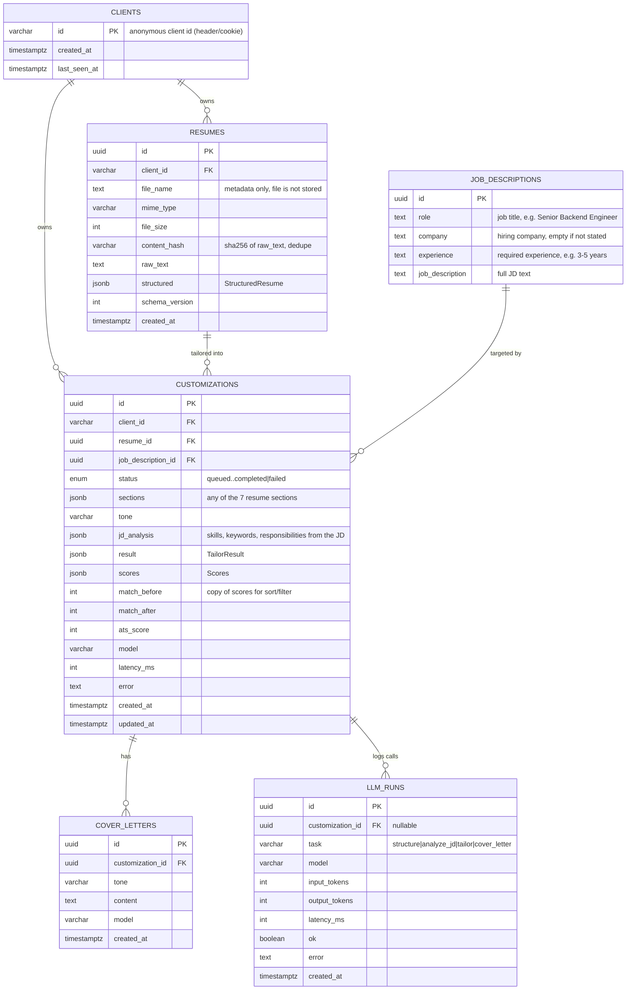

# Database design (JSON-only, no files stored)

Principle: uploaded files are parsed, then thrown away. Postgres keeps only
**extracted text + structured JSON**. Exports (PDF/DOCX/TXT) are rendered on demand from JSON.

## ER diagram



## What changes vs. today

| Area | Today | Proposed | Why |
|---|---|---|---|
| Owner | `client_id` string on two tables, no table | `clients` table, FKs from resumes + customizations | Integrity. The `users` scaffold table is removed. |
| Resume dedupe | none | `content_hash` + unique `(client_id, content_hash)` | Re-uploading the same resume reuses the cached `structured` JSON, so no LLM call. |
| JD table | `content_hash`, `content`, `requirements` JSON | only `role`, `company`, `experience`, `job_description` | Simple table. The history list shows titles without parsing JSON. |
| Scores | only inside `scores` JSON | also `match_before`, `match_after`, `ats_score` ints | Sort and filter by score with a plain index. JSON stays the source of detail. |
| JSON evolution | none | `schema_version` on stored JSON | Old rows stay readable when shapes change. |
| LLM observability | `model`, `latency_ms` on customization | `llm_runs` table | Per-call tokens, latency and errors, which makes cost debugging possible. |
| Validation | app-level only | `CHECK` on status/tone, JSON type checks | Bad rows can't enter via a stray script. |
| Retention | none | cleanup job: delete clients' data older than N days | The product is anonymous, so don't keep data forever. |

Keep as JSON: `structured`, `sections`, `result`, `scores` (always read whole, never queried by inner field).
Promote to columns: anything you filter, sort, or join on.

## Proposed Drizzle schema

```js
import { sql } from 'drizzle-orm'
import { boolean, check, index, integer, jsonb, pgEnum, pgTable, text, timestamp, uniqueIndex, uuid, varchar } from 'drizzle-orm/pg-core'

const ts = (name) => timestamp(name, { withTimezone: true }).defaultNow().notNull()

export const customizationStatus = pgEnum('customization_status',
  ['queued', 'analyzing', 'tailoring', 'scoring', 'completed', 'failed'])

export const clients = pgTable('clients', {
  id: varchar('id', { length: 64 }).primaryKey(),
  createdAt: ts('created_at'),
  lastSeenAt: ts('last_seen_at'),
})

export const resumes = pgTable('resumes', {
  id: uuid('id').primaryKey().defaultRandom(),
  clientId: varchar('client_id', { length: 64 }).notNull().references(() => clients.id, { onDelete: 'cascade' }),
  fileName: text('file_name').notNull(),
  mimeType: varchar('mime_type', { length: 128 }).notNull(),
  fileSize: integer('file_size').notNull(),
  contentHash: varchar('content_hash', { length: 64 }).notNull(),
  rawText: text('raw_text').notNull(),
  structured: jsonb('structured'),
  schemaVersion: integer('schema_version').notNull().default(1),
  createdAt: ts('created_at'),
}, (t) => [
  uniqueIndex('resumes_client_hash_uq').on(t.clientId, t.contentHash),
  index('resumes_client_created_idx').on(t.clientId, t.createdAt),
])

export const jobDescriptions = pgTable('job_descriptions', {
  id: uuid('id').primaryKey().defaultRandom(),
  role: text('role').notNull().default(''),
  company: text('company').notNull().default(''),
  experience: text('experience').notNull().default(''),
  jobDescription: text('job_description').notNull(),
})

export const customizations = pgTable('customizations', {
  id: uuid('id').primaryKey().defaultRandom(),
  clientId: varchar('client_id', { length: 64 }).notNull().references(() => clients.id, { onDelete: 'cascade' }),
  resumeId: uuid('resume_id').notNull().references(() => resumes.id, { onDelete: 'cascade' }),
  jobDescriptionId: uuid('job_description_id').notNull().references(() => jobDescriptions.id),
  status: customizationStatus('status').notNull().default('queued'),
  sections: jsonb('sections').notNull(),
  tone: varchar('tone', { length: 32 }).notNull(),
  result: jsonb('result'),
  scores: jsonb('scores'),
  matchBefore: integer('match_before'),
  matchAfter: integer('match_after'),
  atsScore: integer('ats_score'),
  model: varchar('model', { length: 64 }).notNull(),
  latencyMs: integer('latency_ms'),
  error: text('error'),
  createdAt: ts('created_at'),
  updatedAt: ts('updated_at'),
}, (t) => [
  index('customizations_client_created_idx').on(t.clientId, t.createdAt),
  index('customizations_status_idx').on(t.status),
  index('customizations_resume_idx').on(t.resumeId),
  check('customizations_tone_chk', sql`${t.tone} in ('professional','confident','concise')`),
  check('customizations_sections_chk', sql`jsonb_typeof(${t.sections}) = 'array'`),
  check('customizations_scores_chk', sql`(${t.matchAfter} is null or ${t.matchAfter} between 0 and 100)`),
])

export const coverLetters = pgTable('cover_letters', {
  id: uuid('id').primaryKey().defaultRandom(),
  customizationId: uuid('customization_id').notNull().references(() => customizations.id, { onDelete: 'cascade' }),
  tone: varchar('tone', { length: 32 }).notNull(),
  content: text('content').notNull(),
  model: varchar('model', { length: 64 }),
  createdAt: ts('created_at'),
}, (t) => [index('cover_letters_customization_idx').on(t.customizationId)])

export const llmRuns = pgTable('llm_runs', {
  id: uuid('id').primaryKey().defaultRandom(),
  customizationId: uuid('customization_id').references(() => customizations.id, { onDelete: 'set null' }),
  task: varchar('task', { length: 32 }).notNull(),
  model: varchar('model', { length: 64 }).notNull(),
  inputTokens: integer('input_tokens'),
  outputTokens: integer('output_tokens'),
  latencyMs: integer('latency_ms'),
  ok: boolean('ok').notNull(),
  error: text('error'),
  createdAt: ts('created_at'),
}, (t) => [index('llm_runs_customization_idx').on(t.customizationId)])
```

## Example JSON for every JSON column

### `resumes.structured` (StructuredResume)
```json
{
  "name": "Jane Doe",
  "headline": "Backend Engineer",
  "contact": ["jane@example.com", "+91 98765 43210", "linkedin.com/in/janedoe", "Pune, India"],
  "summary": "Backend engineer with 4 years building Node.js and PostgreSQL services for fintech products.",
  "skills": ["JavaScript", "TypeScript", "SQL", "Node.js", "Express", "REST", "Redis", "Docker", "Git", "GitHub Actions"],
  "experience": [
    {
      "title": "Software Engineer",
      "company": "Acme Payments",
      "location": "Pune",
      "period": "Jun 2022 - Present",
      "bullets": [
        "Built a payments API handling 2M requests/day with p95 under 120 ms.",
        "Cut report generation time from 40 s to 6 s by moving it to a queue."
      ]
    }
  ],
  "projects": [
    {
      "name": "Resume Tailor",
      "tech": "Node.js, Postgres, Gemini",
      "bullets": ["Built an ATS-scoring pipeline that tailors resumes to a job description."]
    }
  ],
  "education": [
    { "degree": "B.Tech, Computer Science", "institution": "PICT Pune", "period": "2018 - 2022", "details": "CGPA 8.6" }
  ],
  "certifications": ["AWS Certified Cloud Practitioner"],
  "additional": [
    { "title": "Languages", "items": ["English", "Hindi"] }
  ]
}
```

### `job_descriptions` row

The table has only four data columns (plus the `id` key), and works for any job type, not only tech.
Anything the JD does not state is an empty string (never invented). There is no JSON column on this table.

| Column | Type | Notes |
|---|---|---|
| `role` | text | Job title as stated, `''` if absent |
| `company` | text | Hiring company as stated, `''` if absent |
| `experience` | text | Required experience as stated, e.g. `3-5 years`, `''` if absent |
| `job_description` | text | The full JD text |

Tech example:
```json
{
  "id": "b7c1d0a2-5e3f-4c8a-9d21-7a4f6e1b2c33",
  "role": "Senior Backend Engineer",
  "company": "Globex",
  "experience": "5+ years",
  "job_description": "We are looking for a Senior Backend Engineer to design and own backend services... Must have Node.js, PostgreSQL, Docker. Nice to have Kafka, AWS."
}
```

Non-tech example:
```json
{
  "id": "0e9a4f7b-1c62-4d3e-8b50-2f9c7d6a1e44",
  "role": "Registered Nurse - ICU",
  "company": "City General Hospital",
  "experience": "2 years critical care",
  "job_description": "Monitor critically ill patients, administer medications and titrate drips. Active RN license, BLS and ACLS required."
}
```

Sparse JD (company and experience not stated):
```json
{
  "id": "4d2b8c90-7a1e-4f55-b3c6-9e0a5d7f8b12",
  "role": "Sales Associate",
  "company": "",
  "experience": "",
  "job_description": "Assist customers on the shop floor, handle cash and use the POS. Customer service skills needed."
}
```

Skills, keywords and responsibilities are not stored on this table. The LLM extracts them per
customization into `customizations.jd_analysis` (see below), and the pipeline also copies `role`,
`company` and `experience` from that analysis onto this row. Each customization owns its own
`job_descriptions` row, so a JD pasted twice is analyzed twice.

### `customizations.jd_analysis` (JdRequirements)
```json
{
  "role": "Senior Backend Engineer",
  "company": "Globex",
  "experience": "5+ years",
  "seniority": "senior",
  "mustHaveSkills": ["Node.js", "PostgreSQL", "REST APIs", "Docker"],
  "niceToHaveSkills": ["Kafka", "AWS", "Terraform"],
  "keywords": ["microservices", "scalability", "CI/CD", "observability"],
  "responsibilities": ["Design and own backend services end to end", "Mentor junior engineers"]
}
```
Unstated values are `""` or `[]`. Scoring reads `mustHaveSkills`, `niceToHaveSkills` and `keywords`.

### `customizations.sections`

The list of resume sections this customization is allowed to rewrite. The allowed keys are every
section of the structured resume:

`summary`, `skills`, `experience`, `projects`, `education`, `certifications`, `additional`

Default (all sections):
```json
["summary", "skills", "experience", "projects", "education", "certifications", "additional"]
```

User picked only some:
```json
["summary", "skills", "experience"]
```

Sections not in the list are copied unchanged from the original resume. A `CHECK` can enforce that
every element is one of the seven keys.

Fields that are never rewritten, whatever `sections` says: `name`, `contact`, job titles, companies,
dates, degrees and institutions. Only wording (summary text, skill lists, bullets) changes.

### `customizations.result` (TailorResult + unverifiedSkills)
```json
{
  "resume": { "...": "same shape as StructuredResume above, tailored" },
  "changes": [
    { "section": "summary", "description": "Reworded to lead with Node.js and PostgreSQL, matching the JD." },
    { "section": "skills", "description": "Moved Docker and REST up; added CI/CD from existing GitHub Actions experience." }
  ],
  "missingKeywords": [
    { "keyword": "Kafka", "suggestion": "Add it only if you have used it, e.g. under a project that consumed events." }
  ],
  "unverifiedSkills": ["CI/CD"]
}
```

### `customizations.scores` (Scores)
```json
{
  "match": {
    "before": 42,
    "after": 78,
    "matched": ["node.js", "postgresql", "docker", "rest apis"],
    "missing": ["kafka", "terraform"]
  },
  "ats": {
    "score": 83,
    "passed": 8,
    "total": 9,
    "checks": [
      { "name": "JD keyword coverage", "points": 35, "earned": 34, "passed": false, "tip": "Add more truthful JD keywords to your skills and bullets." },
      { "name": "Professional summary", "points": 10, "earned": 10, "passed": true },
      { "name": "Phone in header", "points": 5, "earned": 5, "passed": true }
    ]
  }
}
```

`match_before`, `match_after`, `ats_score` columns are copied from `scores.match.before`, `scores.match.after`, `scores.ats.score` when the pipeline completes.

### Cover letter (plain text column, no JSON)
```json
{
  "id": "6f1c0e9e-2d6b-4b0f-9a52-0c1f3f5c9a11",
  "customizationId": "3f2a7c1d-8b44-4c56-a1de-5f6f0c9e7d20",
  "tone": "professional",
  "content": "Dear Hiring Manager,\n\nI am excited to apply for the Senior Backend Engineer role at Globex...",
  "model": "gemini-3.5-flash"
}
```

### `llm_runs` row
```json
{
  "task": "tailor",
  "model": "gemini-3.5-flash",
  "inputTokens": 3120,
  "outputTokens": 1480,
  "latencyMs": 5400,
  "ok": true,
  "error": null
}
```

## Migration plan (when you want it)
1. Add `clients`, backfill from `SELECT DISTINCT client_id` on resumes and customizations, then add the FKs.
2. Add new nullable columns (`content_hash` on resumes, `match_*`, `ats_score`, `schema_version`, `model`), and reshape `job_descriptions` to `role`, `company`, `experience`, `job_description`, backfill, then add NOT NULL, unique and check constraints.
3. Add `llm_runs`, then log from `gemini.client.js`.
4. Add `ON CONFLICT (client_id, content_hash)` reuse in `resume.service.js`.
5. Add a nightly job that deletes data older than your retention window.

Use `npx drizzle-kit generate`, review the SQL, then migrate. Don't edit applied migrations.

## API (CRUD)

All routes are under `/api` and need the `X-Client-Id` header (a UUID). The client row is created on first use.
Rows owned by another client return 404.

| Method | Path | What it does |
|---|---|---|
| POST | `/resumes` | Upload PDF/DOCX (field `file`). Same text again returns the existing row (dedupe by `content_hash`). |
| GET | `/resumes` | List uploaded resumes, newest first. |
| GET | `/resumes/:id` | One resume incl. `structured` JSON (null until first customization). |
| DELETE | `/resumes/:id` | Delete it and its customizations (204). |
| POST | `/customizations` | Start a tailoring job. Body: `resumeId`, `jobDescription`, `sections`, `tone`. Returns 202. |
| GET | `/customizations` | History with role, company, match and ATS scores. |
| GET | `/customizations/:id` | Detail / polling: status, original, result, scores, cover letter. |
| DELETE | `/customizations/:id` | Delete it, its job description and cover letters (204). `llm_runs` stay with a null id. |
| GET | `/customizations/:id/export?format=pdf\|docx\|txt` | Download the tailored resume as a file. |
| POST | `/customizations/:id/cover-letter` | Generate a cover letter (201). |
